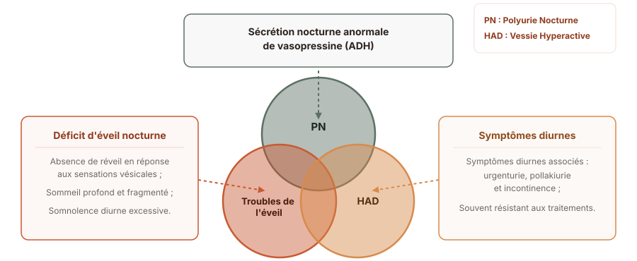
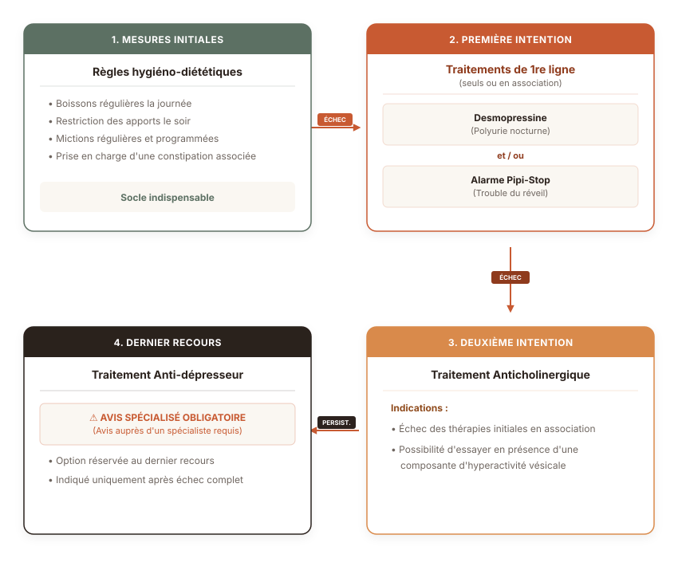

# Les définitions selon l'ICCS {.center .section-slide}
*(International Continence Child Society)*

## L'énurésie

L’énurésie correspond à l’émission passive d’urine sur le temps du sommeil à partir de l’âge de 5 ans et plus.

::: {.g-card-blue}
Il faut différencier les énurésies **primaires** et **secondaires** :

- primaire : apparition dès l’enfance sans période sèche prolongée, 
- secondaire : apparition après au moins 6 mois consécutifs sans trouble.
:::

## L'énurésie

Deux termes sont à différencier : monosymptomatique (MNE) et non-monosymptomatique (NMNE).

::: {.g-card-green}
Une énurésie non-monosymptomatique est l’émission d’urine au cours du sommeil associée à au moins 1 des symptômes suivants : 

- incontinence urinaire diurne,
- urgenturie,
- dysurie,
- anomalie de fréquence des mictions (trop peu <4 ou trop > 7).

:::

Les prises en charge des MNE et NMNE seront différentes.

## La capacité vésicale théorique

Des normes sont fixées par l'International Continence Child Society (ICCS) :

La **C**apacité **V**ésicale **T**héorique en mL :

$$ \text{CVT} = (\text{âge} + 1) \times 30 $$

::: {.small-text}
*L'âge est exprimé en années.*
:::

::: {.g-card-red}
Cette formule est valide de 3 ans jusqu’à l’âge de 13 ans environ où la capacité vésicale théorique atteint 400 ml environ (capacité vésicale adulte).
:::

## La polyurie nocturne

La polyurie nocturne correspond à une production anormale d’urine au cours de la nuit. 

::: {.g-card}
La définition actuelle donne un volume uriné au cours de la nuit supérieur ou égal à 130% de la CVT.
:::

## La prévalence

::: {.g-card-green}
C’est un trouble fréquent.
:::

Selon une cohorte finlandaise (>3000 enfants) et une cohorte australienne (> 2000 enfants), l’énurésie concerne : 

- 5 à 10 % des enfants de 7 ans,
- 3 % des enfants de 11 à 14 ans,
- 0,5 à 1% des adultes restent énurétiques.

*Sources : [@jarvelin1988enuresis], [@bower1996epidemiology]*.

## La physiopathologie

Plusieurs hypothèses existent : 

- l'hérédité familiale, 
- le sommeil perturbé, 
- la production d'urine majorée, 
- l'hyperactivité détrusorienne,
- les causes psychologiques,
- le dysfonctionnement du système nerveux central.

::: {.g-card-green}
La physiopathologie de l’énurésie est assurément multifactorielle.
:::

## La physiopathologie

:::{.center}

:::

*Sources : [@neveus_diagnosis_2009], [@sinha2016management]*.

## Les troubles du sommeil : cause ou conséquence ?

*Source : [@van2016desmopressin]*.

# La prise en charge diagnostique {.center .section-slide}

## Éliminer les diagnostics différentiels

Les principaux troubles associés à identifier pour le diagnostic étiologique sont : 

- les troubles psychiatriques
- la constipation
- les infections urinaires
- les ronflements ou apnée du sommeil.

::: {.g-card-green}
S’il s’agit d’un tableau d’énurésie primaire isolée : aucun examen biologique, radiologique ou urodynamique n’est nécessaire.
:::

## Prendre en charge les troubles associés

- Les troubles psychiatriques : rarement la seule cause mais indispensable à prendre en charge
- L’énurésie peut avoir des conséquences psychiatriques et psychologiques : sur l’estime de soi par exemple

*Source : [@von2015comorbidity]*.

- La constipation : très fréquente pour les enfants atteints de NMNE et MNE

*Sources : [@loening-baucke_urinary_1997], [@soderstrom2004urinary]*.

- Une infection urinaire
- Les troubles respiratoires nocturnes : 50% des enfants avec énurésies et troubles respiratoires nocturnes deviendront secs après ablation des amygdales et végétations

## Prendre en charge les troubles associés

::: {.font-small}
**Tableau — Signes d'alerte lors de l'évaluation initiale d'un enfant énurétique**

::: {.table-modern}
| Signe d'alerte | Conduite à tenir |
| :--- | :--- |
| **Perte de poids, retard de croissance et/ou nausées** | Contrôle de la créatininémie et de la glucosurie. Examen physique. |
| **Soif excessive avec besoin de boire la nuit (polydipsie)** | Contrôle de la glucosurie. Calendrier mictionnel / apports hydriques. Envisager créatininémie et osmolalité urinaire du matin. Examen physique. |
| **Difficultés mictionnelles** *(jet faible, besoin de pousser)* | Débitmétrie urinaire et mesure du résidu post-mictionnel. Examen physique. |
| **Énurésie nocturne secondaire** *(apparition récente)* | Contrôle de la glucosurie. Examen physique. |
| **Ronflements importants ou apnées du sommeil** | Avis ORL (oto-rhino-laryngologiste). Examen physique. |
:::
:::

# Le bilan minimal nécessaire

## L'interrogatoire

1. identifier MNE et NMNE
2. enquêter sur l’histoire familiale
3. évaluer les troubles urinaires diurnes
4. éliminer un diabète 
5. repérer des troubles du transit : constipation +++
6. dépister des troubles du sommeil, et respiratoires
7. repérer des troubles du comportement ou des intéractions sociales : violences …
8. lister les traitements déjà testés pour ces symptômes

## L'examen clinique

Les principaux éléments à rechercher sont : 

- à l’examen neurologique : déficit musculaires ou asymétrie
- malformations des organes génitaux externes
- signe de dysraphisme sur le raphée médian

## Calendrier mictionnel

Pour : 

- Évaluer la capacité vésicale par rapport à la capacité vésicale théorique
- Vérifier l’absence de trouble urinaire diurne
- Évaluer les volumes urinés au cours de la nuit : recherche de polyurie nocturne.

::: {.g-card-green}
Et rien d’autre dans le cadre d’une énurésie monosymptomatique primaire.
:::

## La prise en charge thérapeutique {.center}

::: {.text-center}
{style="max-height: 50vh !important; width: auto; margin: 0 auto;"}
:::

## Les règles hygiéno-diététiques

Il est nécessaire d’informer de manière systématique :

- sur le taux de guérison spontanée sur les cohortes d’enfants énurétiques est de 15% tous les ans → réassurance,
- sur l’importance de la répartition des boissons dans la journée,
- sur la nécessité de réaliser une miction systématique au lever et au coucher,
- sur l’importance d’arrêter le port des couches, surtout si une amélioration se produit.	

## La prescription de la desmopressine

::: {.g-card}
C’est un analogue de l'hormone anti-diurétique.
:::

**L’autorisation de mise sur le marché (AMM) précise :**

- L’indication : énurésie à partir de l’âge de 6 ans,
- La posologie : débuter à 60 µg, puis augmenter de 60 µg / semaine jusqu'à 360 µg si nécessaire,

::: {.g-card-green}
- si inefficace : arrêt du traitement après 4 semaines à dose maximale,
- si efficace : rester à la dose minimale efficace pour un traitement de 3 mois, renouvelable si besoin.
:::

## La prescription de la desmopressine

**Les précautions d’emploi sont :**

- d’éliminer une pathologie rénale associée,
- d’informer sur le risque d'hyponatrémie : 
  - minime en pédiatrie. 

::: {.g-card-red}
Il est recommandé d’arrêter de boire 1h avant la prise et pendant 8h après.
:::

**Les recommandations sont de :**

- privilégier la voie orale à nasale (meilleure disponibilité),
- trouver la dose minimale efficace.

## Les anticholinergiques autorisés

::: {.g-card}
Trois spécialités ont l’AMM en pédiatrie. Leur prescription nécessite de vérifier le résidu post-mictionnel (RPM) tous les 3 à 6 mois par échographie ou *bladder-scan*.
:::

**Oxybutynine :**

- Autorisé à partir de 5 ans,
- A une dose de 0,3 à 0,4 mg/kg/jour en 2 à 3 prises,
- Disponible en comprimé de 5 mg ou en suspension buvable sur autorisation temporaire d’utilisation (ATU),
- Sa demi-vie est courte < 1,5 heure, et nécessite plusieurs prises par jour,
- Les effets secondaires principaux sont l’imprégnation atropinique et le passage de la barrière hémato-encéphalique (BHE).

*Sources : [@blais2016prospective]*.

## Les anticholinergiques autorisés

**Chlorure de trospium :**

- Autorisé à partir de 12 ans,
- Disponible en comprimé de 20 mg à raison de 2x / jour, sans adaptation au poids,
- Sa demi-vie est plus longue : 6 heures,
- Les effets secondaires principaux sont l’imprégnation atropinique (passage de la BHE limité).

**Solifénacine :**

- Autorisé à partir de 2 ans,
- Disponible en sirop de 1 mg/ml ou en comprimé de 5 ou 10 mg,
- Le sirop n’est pas remboursé par la sécurité sociale suite à la synthèse de l'HAS (ANSMR V).

::: {.g-card-red}
**Mirabegron :**

- Non autorisé en France
- Les études internationales décrivent une bonne tolérance
:::

## Les antidépresseurs tricycliques : en dernier recours
	
**L’autorisation de mise sur le marché (AMM) précise :**

- une indication dans le cadre d'une énurésie à partir de 6 ans
- une posologie de 10 à 50 mg au coucher ou 1 à 2,5mg/kg *(doses inférieures à celles prescrites dans le syndrome dépressif)*,
	
**Des précautions sont nécessaires avant la mise en place du traitement :**

- Réaliser un ECG : risque de cardiotoxicité,
- Réaliser un bilan sanguin avec bilan hépatique : risque d’hépatotoxicité,
	
**Les effets indésirables principaux sont :**

- L’effet anti-cholinergique,
- Des troubles de l’humeur lors d’un arrêt brutal,
	
::: {.g-card-blue}
En pratique, ce traitement est peu ou pas utilisé.

[@glazener2000tricyclic] ont montré qu’une prise quotidienne permettait de diminuer la fréquence de l'énurésie d’1 nuit / semaine.
:::

# Bibliographie {.center}

::: {#refs}
::: 