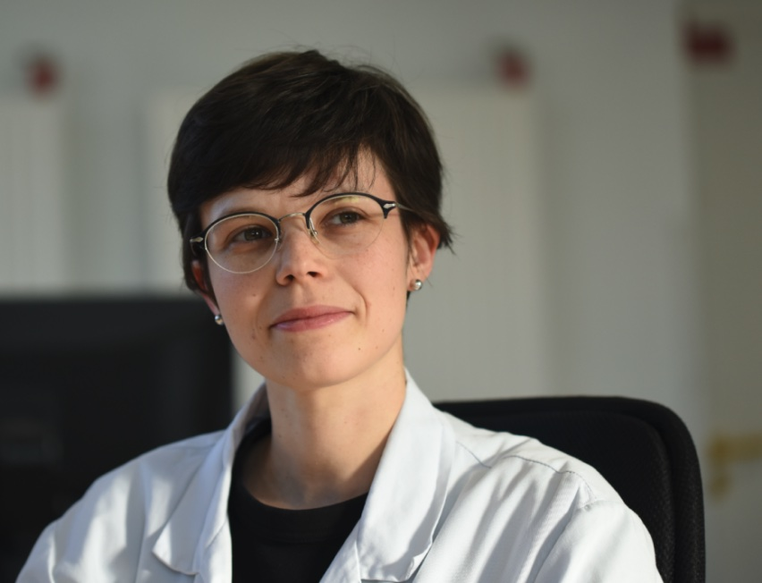

::: {.card .p-4 .mb-4 style="border-left: 4px solid #C85A32 !important;"}
::: {.grid .align-items-center}
::: {.g-col-12 .g-col-md-9}
# Dr Pauline Lallemant‑Dudek

Sorbonne Université
AP-HP Armand-Trousseau
MPR Pédiatrique

**Maître de conférences universitaire — Praticien hospitalier** à Sorbonne Université et Cheffe de service en Médecine Physique et Réadaptation Pédiatrique à l'Hôpital Armand-Trousseau. 

Ce portail centralise l'ensemble des activités d'enseignement, les supports de cours ainsi que le parcours académique et scientifique.
:::

::: {.g-col-12 .g-col-md-3 .text-center}
{width=250px}
:::
:::
:::

## 📅 Prise de rendez-vous & Consultations

::: {.card .p-4 .mb-4}
### Service de Médecine Physique et Réadaptation Fonctionnelle Pédiatrique
**Hôpital Armand-Trousseau (AP-HP)**  
*Consultation publique — Conventionnée secteur 1 (tarifs AP-HP)*

::: {.grid .mt-3}

::: {.g-col-12 .g-col-md-6}
#### 📍 Adresse & Secrétariat
**Hôpital Armand-Trousseau**  
26 avenue du Docteur Arnold-Netter  
75012 Paris  

- **Secrétariat / Prise de RDV :** `01 44 73 68 51`
- **Réservation en ligne :** [Prendre rendez-vous sur Doctolib ↗](https://www.doctolib.fr/medecine-physique-et-de-readaptation/paris/pauline-lallemant?agenda_ids%5B%5D=42523){.btn .btn-sm .btn-primary .mt-2 target="_blank"}
:::

::: {.g-col-12 .g-col-md-6}
#### 🚆 Comment venir à l'hôpital ?
- **Métro :** Ligne 1 (Porte de Vincennes, Nation), Ligne 6 (Bel-Air, Picpus), Ligne 8 (Daumesnil, Michel Bizot)
- **Bus :** Ligne 64 (Arrêt Hôpital Trousseau), Lignes 29, 56 (Av. de Saint-Mandé), Ligne 26 (Cours de Vincennes)
- **RER & Tram :** RER A (Nation) / Tramway T3a (Montempoivre, Alexandra David-Néel)

[Consulter le plan de l'hôpital (PDF) ↗](https://www.aphp.fr/sites/default/files/migrate-files/088%2020250210_plan_105.jpg){.btn .btn-sm .btn-outline-primary .mt-2 target="_blank"}
:::

:::

::: {.callout-note appearance="simple" .mt-3}
**Vous êtes médecin de ville ?**  
Pour adresser vos patients ou bénéficier d'une expertise médicale, veuillez vous référer directement au [Service de Médecine Physique et Réadaptation fonctionnelle pédiatrique de l'Hôpital Trousseau ↗](https://www.aphp.fr/offre-de-soin/service/42){target="_blank"}.
:::
:::

## 🧭 Naviguer sur le site

::: {.grid .mt-4}

::: {.g-col-12 .g-col-md-6}
::: {.card .h-100 .p-4}
### 📚 Espace Cours & Enseignement
Accédez aux supports de cours rédigés sous Quarto et intégrés en diaporamas interactifs Reveal.js (DIU Neuro-urologie, DES MPR, UE Santé-Handicap).

[Consulter les cours →](cours/index.qmd){.btn .btn-outline-primary .mt-2}
:::
:::

::: {.g-col-12 .g-col-md-6}
::: {.card .h-100 .p-4}
### 🔬 Parcours & Curriculum Vitae
Découvrez le détail des travaux de recherche en neurosciences, publications dans des revues internationales, communications orales et distinctions.

[Explorer le CV complet →](cv.qmd){.btn .btn-outline-primary .mt-2}
:::
:::

:::